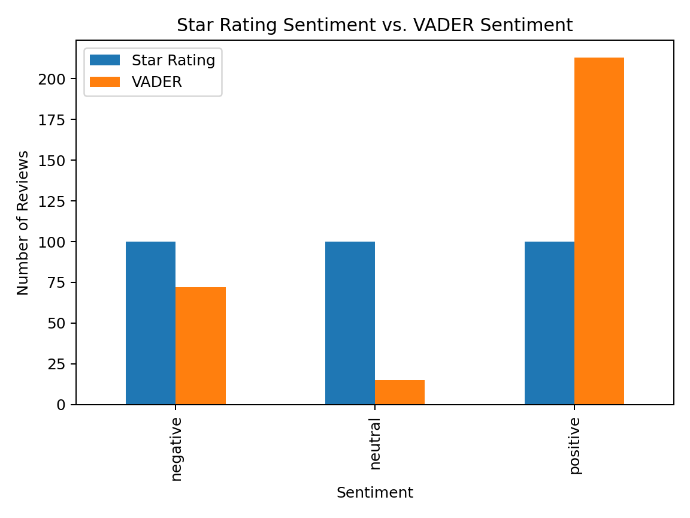
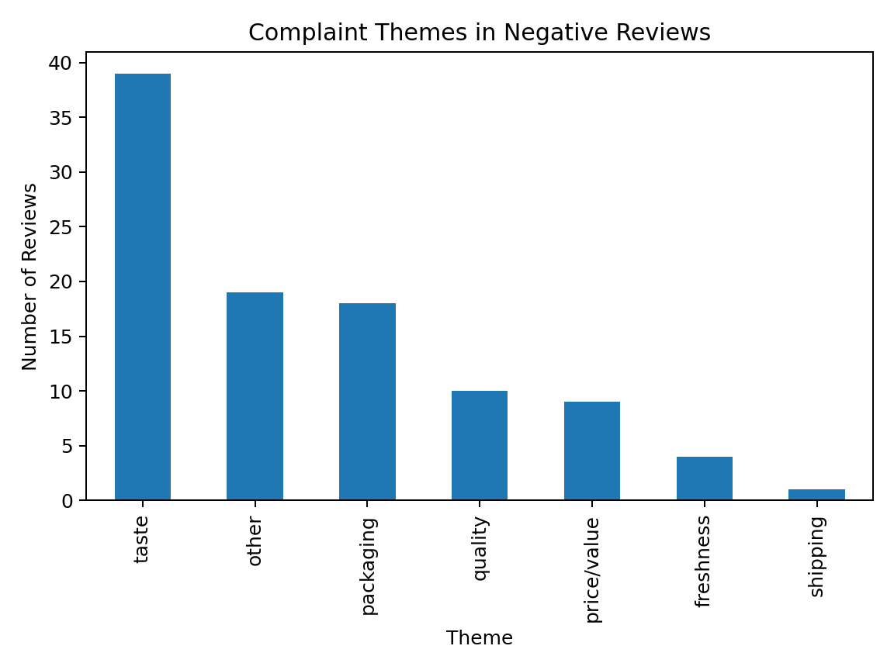

# Amazon Review Analytics | Python, NLP & Business Intelligence

A portfolio-ready Python and NLP project that converts unstructured Amazon customer-review text into sentiment metrics, complaint themes, product-level insights, and decision-support outputs.

## Project Overview

**Business question:** What can customer-review text tell us that a star rating cannot?

The source dataset contains **568,454 Amazon Fine Food Reviews across 74,258 products**. For a manageable and balanced evaluation, the project uses a reproducible **300-review stratified sample across 10 products**:

- 100 positive reviews
- 100 neutral reviews
- 100 negative reviews
- 30 reviews per product
- `random_state=42` for repeatable sampling

The workflow combines **Pandas**, **NLTK VADER**, tokenization, stop-word removal, rule-based text classification, error analysis, and **Matplotlib** visualizations.

## Technical Workflow

```text
568K+ Raw Reviews
        ↓
Data Cleaning + Filtering
        ↓
Stratified Random Sampling
        ↓
Rating-Derived Sentiment Labels
        ↓
NLTK VADER Sentiment Scoring
        ↓
Agreement / Failure Analysis
        ↓
Tokenization + Stop-Word Removal
        ↓
Keyword-Based Complaint Classification
        ↓
Product-Level Aggregation
        ↓
Business Intelligence / Seller Insights
```

## Tech Stack

| Area | Tools / Methods |
|---|---|
| Programming | Python |
| Data Wrangling | Pandas, DataFrame filtering, grouping, aggregation |
| Sampling | Stratified random sampling, class balancing, reproducible sampling |
| NLP | NLTK VADER, tokenization, stop-word removal |
| Text Analytics | Lexicon-based sentiment scoring, rule-based theme classification |
| Evaluation | Agreement metrics, class-level performance, failure-case analysis |
| Visualization | Matplotlib |
| Outputs | CSV results, charts, product-level decision-support insights |

## Data Sampling

Rather than drawing 300 reviews directly from the full dataset, the project first separates reviews by **product and rating-derived sentiment class**, then randomly selects the same number from each group.

```python
for product in PRODUCTS:
    product_reviews = df[df["ProductId"] == product]

    for sentiment in ["negative", "neutral", "positive"]:
        group = product_reviews[
            product_reviews["RatingSentiment"] == sentiment
        ]

        sample = group.sample(
            n=10,
            random_state=42
        )

        sample_list.append(sample)
```

This produces:

**10 products × 3 sentiment classes × 10 reviews = 300 reviews**

## Sentiment Analysis

Star ratings are converted into comparison labels:

```text
1–2 stars → negative
3 stars   → neutral
4–5 stars → positive
```

NLTK VADER independently scores the review text and assigns a sentiment class from the compound score.

```python
scores = sia.polarity_scores(text)
compound = scores["compound"]

if compound >= 0.05:
    return "positive"
elif compound <= -0.05:
    return "negative"
else:
    return "neutral"
```

## Evaluation Results

The included submitted-run outputs show:

- **Overall agreement:** 48.67% (146/300)
- **Disagreements:** 154/300
- **Positive agreement:** 93%
- **Negative agreement:** 48%
- **Neutral agreement:** 5%

The failure analysis was especially useful because mixed and neutral language often did not align cleanly with the numeric star rating.



## Complaint-Theme Analytics

Negative reviews are tokenized and mapped to business-relevant complaint categories using a Python dictionary and keyword matching.

| Complaint Theme | Negative Reviews |
|---|---:|
| Taste | 39 |
| Other | 19 |
| Packaging | 18 |
| Quality | 10 |
| Price / Value | 9 |
| Freshness | 4 |
| Shipping | 1 |

The strongest recurring signal was **taste**, which appeared in 39 of the 100 negative reviews.



## Business Value

The project converts unstructured review text into structured signals that can help a seller or product team quickly identify recurring issues such as:

- taste / flavor
- packaging
- product quality
- freshness
- price / value
- shipping

The intent is not to replace detailed review reading, but to provide a **first-pass decision-support layer** that helps prioritize where to investigate.

## Repository Structure

```text
amazon-review-analytics-nlp/
├── README.md
├── requirements.txt
├── .gitignore
├── TEAM.md
├── data/
│   ├── README.md
│   └── amazon_reviews_project_sample.csv
├── notebooks/
│   ├── 01_create_balanced_sample.ipynb
│   └── 02_review_analytics.ipynb
├── src/
│   ├── create_sample.py
│   └── review_analytics.py
├── results/
│   ├── vader_results.csv
│   ├── failure_cases.csv
│   ├── product_insights.csv
│   ├── sentiment_comparison.png
│   └── complaint_themes.png
└── docs/
    ├── portfolio_carousel.pdf
    └── technical_case_study.md
```

## How to Run

1. Download the original Amazon Fine Food Reviews `Reviews.csv` file if you want to recreate the sample.
2. Install the dependencies:

```bash
pip install -r requirements.txt
```

3. Create the balanced 300-review sample:

```bash
python src/create_sample.py
```

4. Run the analytics workflow:

```bash
python src/review_analytics.py
```

The analysis script downloads the NLTK `vader_lexicon` and `stopwords` resources when internet access is available.

## Key Skills Demonstrated

`Python` · `Pandas` · `Natural Language Processing (NLP)` · `NLTK VADER` · `Sentiment Analysis` · `Text Analytics` · `Tokenization` · `Text Preprocessing` · `Stratified Sampling` · `Class Balancing` · `Data Cleaning` · `Exploratory Data Analysis` · `Error Analysis` · `Matplotlib` · `Business Intelligence`

## Limitations

- The 300-review sample is deliberately balanced and does not represent the natural sentiment distribution of all Amazon reviews.
- Star ratings are an imperfect comparison label because written language and numeric ratings can conflict.
- VADER is rule-based and can struggle with mixed, neutral, sarcastic, or domain-specific language.
- The complaint-theme dictionary is intentionally small; 19 negative reviews were categorized as `other`.

## Team

Developed by **Afnan Rafid, Christy Johnson, Tiffany Nguyen, Grecia Lopez Gonzalez, and Muataz Mahdi** for Analytics Programming at the University of Oklahoma Gene Rainbolt Graduate School of Business.

## References / Data

- Amazon Fine Food Reviews — Stanford Network Analysis Project / Kaggle
- McAuley, J. J., & Leskovec, J. (2013), *From Amateurs to Connoisseurs: Modeling the Evolution of User Expertise through Online Reviews*
- Hutto, C. J., & Gilbert, E. E. (2014), *VADER: A Parsimonious Rule-Based Model for Sentiment Analysis of Social Media Text*

---

### Portfolio Note

The `results/` folder preserves the metrics and outputs reported in the submitted project. The repository is organized as a technical portfolio version of the original academic work, with the code, sample, outputs, and recruiter-facing project summary separated for easier review.
